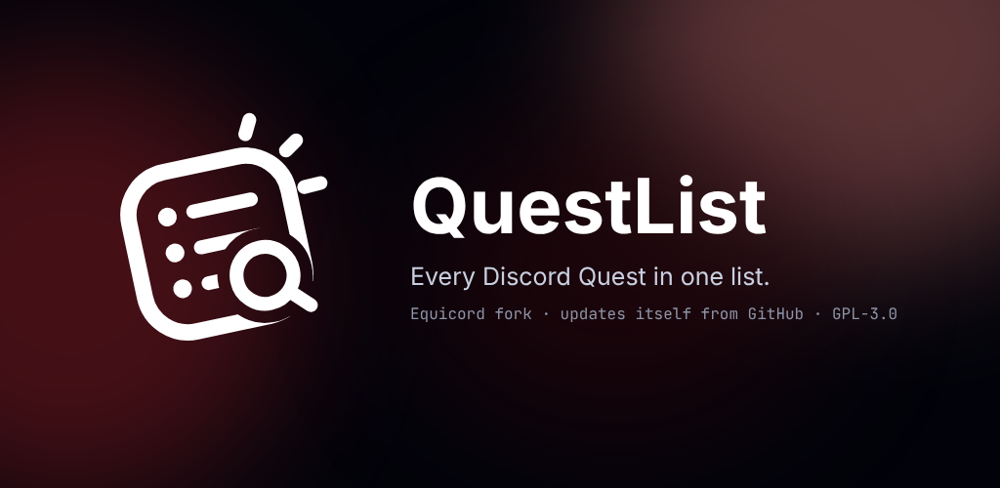
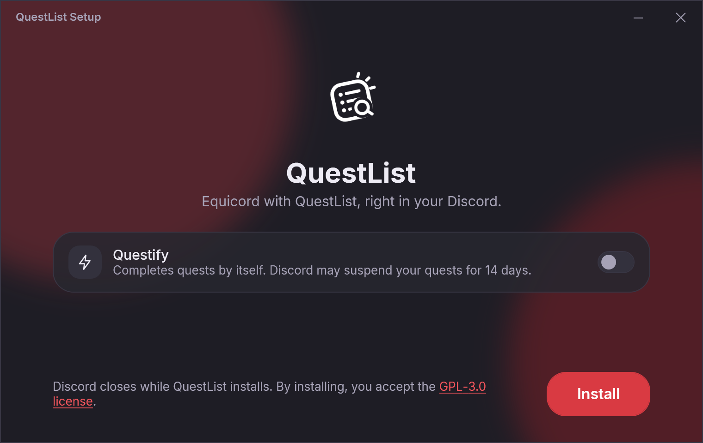
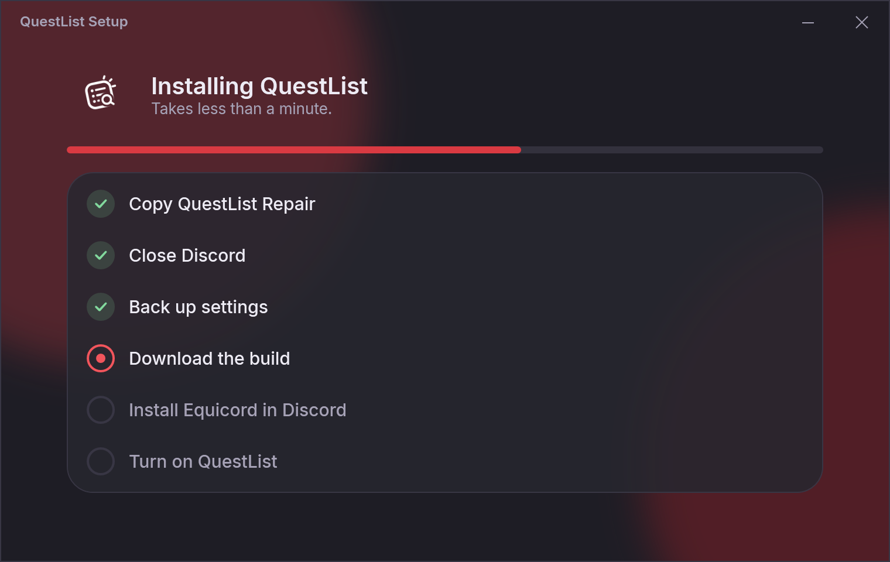
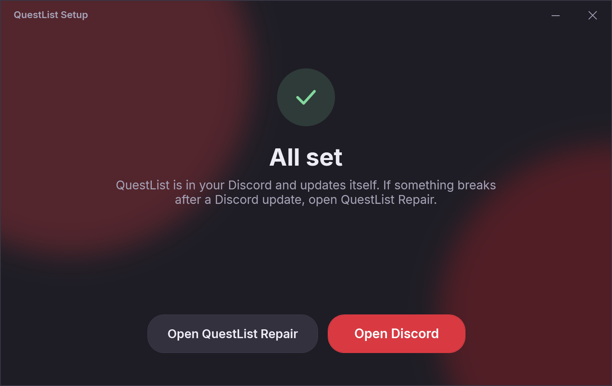

# Equicord-QuestList

A fork of [Equicord](https://github.com/Equicord/Equicord) that ships the **QuestList** plugin, installs with one click and updates itself from this repository.

<a href="https://github.com/tvnclr/Equicord-QuestList/releases/latest/download/QuestList-Setup.exe"><b>Download QuestList-Setup.exe</b></a> · Windows 10 and 11 · Discord, PTB or Canary

## Install

1. Download [QuestList-Setup.exe](https://github.com/tvnclr/Equicord-QuestList/releases/latest/download/QuestList-Setup.exe) and open it.
2. Windows may show "Windows protected your PC", because the setup is not signed. Click **More info**, then **Run anyway**.
3. Choose whether to turn on Questify (read the warning below) and click **Install**. Discord closes for a few seconds and opens again when you click **Open Discord**.

No admin rights are needed. Everything goes to your user folder.

## What you get

- **QuestList**: a button under the server list that opens every Discord Quest in one vertical list with search. It uses Discord's own buttons (Claim Reward, Launch Mission) and does not complete anything by itself.
- **Equicord**, kept in sync with upstream automatically. The built-in updater points at this repository, so updates keep QuestList.
- **QuestList Repair**, in the Start menu. It checks that everything is in place and fixes it with one click, which is mostly needed after a Discord update. It also turns Questify on or off, keeps backups of your Equicord settings, switches back to the official Equicord and uninstalls.

## Quest automation warning

Since April 2026 Discord has been acting against accounts that complete Quests with scripts or plugins (account standing violations and temporary quest bans). QuestList does not automate quests. Equicord's **Questify** plugin does: it stays off unless you turn it on yourself, at your own risk.

## Uninstall

Open **Settings › Apps › Installed apps › QuestList › Uninstall**, or **Uninstall** in QuestList Repair. You can keep the official Equicord in Discord or take Equicord out completely.

## Releases

- Releases marked **Latest** are the stable builds that installs update to.
- Releases marked **Pre-release** are test builds. They may have bugs.
- A new build is made automatically whenever Equicord changes upstream.

## Building

- Equicord with QuestList: `pnpm install --frozen-lockfile`, then `pnpm buildStandalone`.
- QuestList Repair and the setup: `dotnet build questlist/repair -c Release` on Windows. Renaming `QuestListRepair.exe` to `QuestList-Setup.exe` turns it into the setup.

## Credits and license

Equicord and Vencord are by their respective contributors. This fork is distributed under the [GNU General Public License v3.0](../LICENSE), the same license as Equicord. QuestList Repair uses the Inter and JetBrains Mono fonts under the SIL Open Font License.
